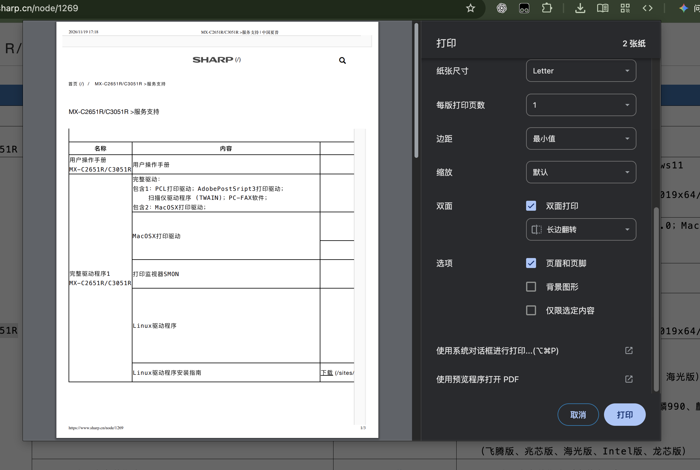
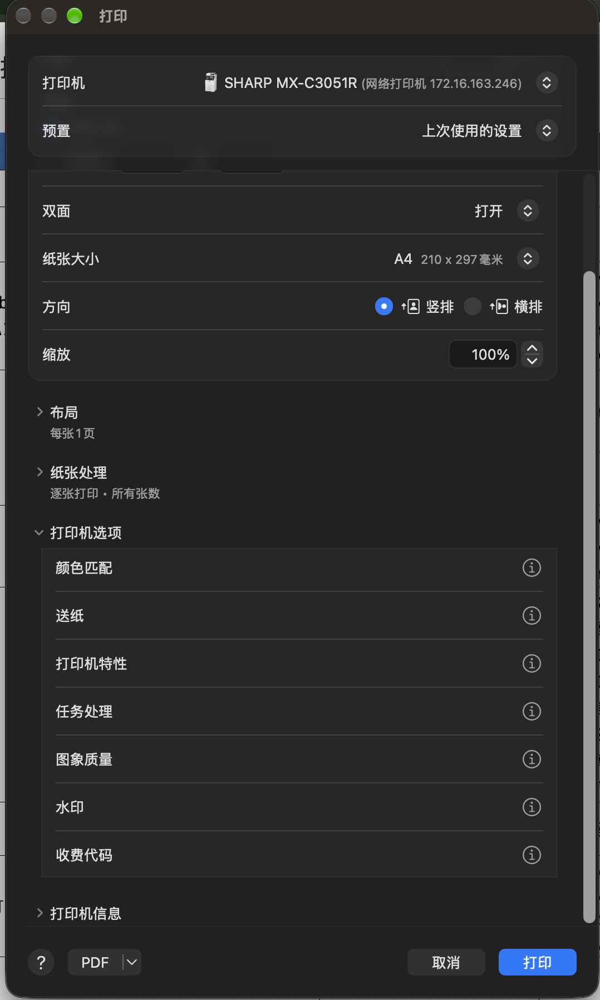
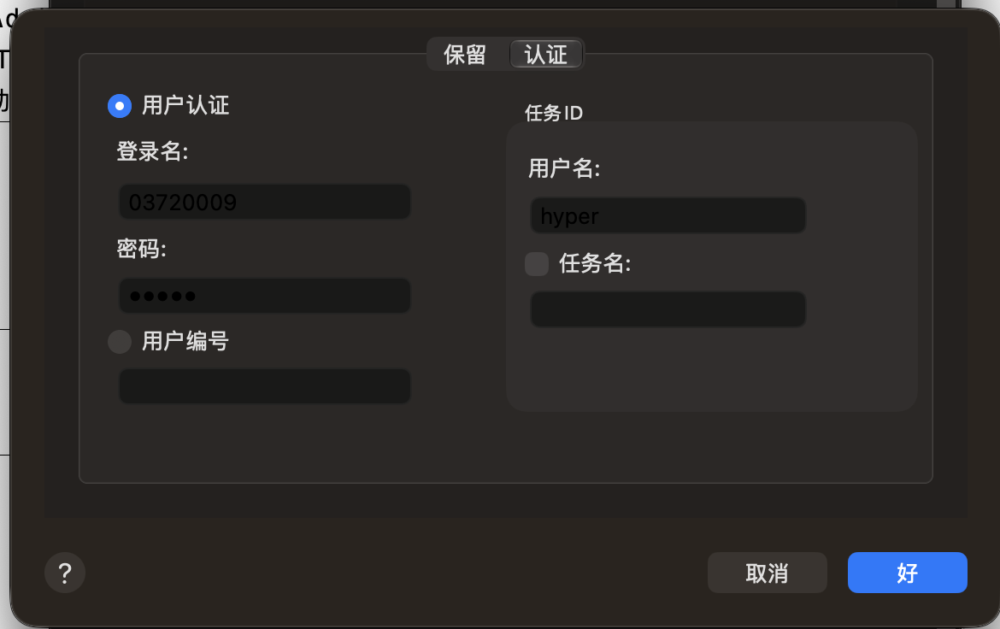
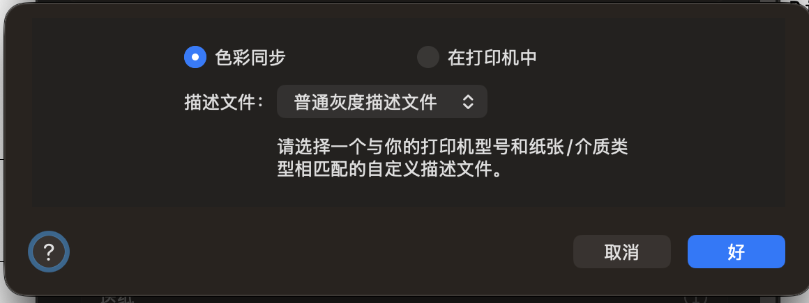

# macOS 一键配置 SHARP MX-C3051R 网络打印机

一个可在 macOS 上**双击运行**的图形化工具：运行后弹出输入框，输入打印机的 IPv4 地址，即可自动完成打印机添加、驱动绑定、设为默认等全部配置。

适用于公司内 Sharp MX-C3051R（及同系列 MX-C2651R）复合机的网络打印场景。

---

## 目录

- [功能特性](#功能特性)
- [快速开始](#快速开始)
- [第一步：获取打印机 IPv4 地址](#第一步获取打印机-ipv4-地址)
- [第二步：一键配置打印机](#第二步一键配置打印机)
- [第三步：在浏览器/网页中打印](#第三步在浏览器网页中打印)
- [打印认证与色彩设置](#打印认证与色彩设置)
- [常见问题](#常见问题)
- [文件说明](#文件说明)

---

## 功能特性

- ✅ 双击 `.app` 即可运行，无需命令行知识
- ✅ 弹出原生输入框，手动填写打印机 IPv4 地址
- ✅ 自动校验 IPv4 地址合法性
- ✅ 自动检测打印机是否可达（ping），并给出网络提示
- ✅ 使用 `socket://` RAW 9100 端口连接（稳定兼容）
- ✅ 自动绑定 Sharp 原厂 PPD 驱动
- ✅ 自动设为系统默认打印机并启用打印队列
- ✅ 全程中文图形化提示，配置结果即时反馈

---

## 快速开始

1. 下载本仓库的 `一键配置打印机.app.zip` 并解压，得到 `一键配置打印机.app`
2. 在打印机面板上查到它的 IPv4 地址（见下文）
3. 双击 `一键配置打印机.app`，输入地址，点击「开始配置」
4. 看到「配置成功」后即可打印

> 💡 首次双击若被系统拦截，右键 →「打开」，或在「系统设置 → 隐私与安全性」中允许运行。

---

## 第一步：获取打印机 IPv4 地址

在 Sharp 打印机机身面板上操作：

1. 点击触摸屏上的 **「设置」/⚙ 图标**
2. 进入 **「网络设置」→「以太网」或「TCP/IP」**
3. 找到 **IPv4 地址**，形如 `172.16.163.246`

将其记下来，下一步会用到。

---

## 第二步：一键配置打印机

1. 双击 `一键配置打印机.app`，弹出如下输入框：

   > 请输入 Sharp 打印机（MX-C3051R）的 IPv4 地址

2. 输入刚才查到的地址（默认已填入 `172.16.163.246`），点击「**开始配置**」
3. 程序会自动完成：地址校验 → 连通检测 → 添加打印机 → 绑定驱动 → 设为默认 → 启用队列
4. 弹出「**✓ 打印机配置成功！**」即表示完成

配置完成后，可在「系统设置 → 打印机与扫描仪」中看到名为 **MX-C3051R** 的打印机。

---

## 第三步：在浏览器/网页中打印

以 Chrome 为例，在网页中按 `Command + P` 调出打印页面。

在预览页右侧找到并点击「**使用系统对话框进行打印… (⌘P)**」：



---

## 打印认证与色彩设置

### 1. 打开系统打印对话框

点击「使用系统对话框进行打印」后，弹出 macOS 系统打印对话框。在「打印机选项」区域可以看到 **任务处理、颜色匹配、送纸** 等选项：



### 2. 设置任务处理（认证）

点击「**任务处理**」选项，切换到「**认证**」标签页：

- 选择 **用户认证**
- 登录名：输入**自己的工号**（例如 `03720009`）
- 密码：`11111`
- 点击「**好**」



> ⚠️ 请填写**自己的工号**，不要用他人的账号，以便正确计费和追溯。

### 3. 设置颜色匹配（灰度）

点击「**颜色匹配**」选项：

- 选择 **「色彩同步」**
- 描述文件选择 **「普通灰度描述文件」**
- 点击「**好**」



### 4. 完成打印

最后点击「**打印**」，然后**到打印机前刷工卡**即可完成出纸。

---

## 常见问题

**Q：双击 app 没反应 / 提示「无法打开，因为来自身份不明的开发者」？**

A：右键点击 app →「打开」，在弹出的对话框中再次点击「打开」；或在「系统设置 → 隐私与安全性」中向下滚动，找到该 app 并点「仍要打开」。本程序为纯 AppleScript，不联网、不上传任何信息。

**Q：提示「无法 ping 通」？**

A：确认 ① 打印机已开机并连网；② 电脑与打印机在同一内网。若公司在用 VPN，请先连接 VPN 后再运行。

**Q：提示「未找到 SHARP MX-C3051R 驱动程序」？**

A：先安装 Sharp 官方 macOS 驱动（MX-C55 驱动包），再运行本程序。仓库中 `SHARP MX-C3051R.PPD.gz` 为驱动描述文件参考。

**Q：打印任务提交后不出纸？**

A：请检查是否在打印机面板完成了**刷工卡**认证；同时确认打印对话框中的「任务处理 → 认证」工号与密码填写正确。

**Q：默认的 IPv4 地址不对？**

A：程序默认填入 `172.16.163.246`，运行时可直接改成你实际查到的地址。也可编辑源码中的 `defaultIP` 后重新编译。

---

## 文件说明

| 文件 | 说明 |
|---|---|
| `一键配置打印机.app` | 可直接双击运行的 macOS 应用 |
| `一键配置打印机.app.zip` | 上面 app 的压缩包，便于下载分发 |
| `OneClickPrinterConfig.applescript` | 程序源码（可自由修改后重新编译） |
| `SHARP MX-C3051R.PPD.gz` | 打印机驱动描述文件（PPD）参考 |
| `screenshots/` | 本文档使用的 4 张操作截图 |

### 从源码重新编译

如果你修改了源码，可用系统自带工具重新编译：

```bash
osacompile -o "一键配置打印机.app" OneClickPrinterConfig.applescript
```

---

## 作者

[hyper-jiawei](https://github.com/hyper-jiawei)

---

*本工具仅用于简化公司内部打印机的配置流程，打印认证请务必使用本人信息。*
